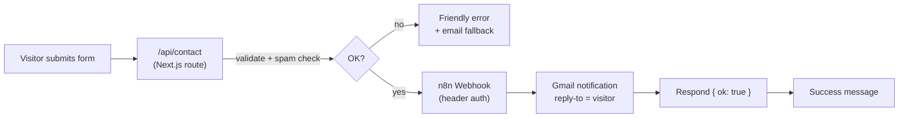

# Work with Zeki | Automation Portfolio

**Live site → [workwithzeki.vercel.app](https://workwithzeki.vercel.app)**

The portfolio of **Exequiel "Zeki" Boribor**, Workflow & AI Automation Specialist. I build automations with n8n, Make, Zapier, and LLMs that take repetitive work off a team's plate: lead intake, CRM sync, compliance tracking, and AI-assisted document and content pipelines.

This repo is the site itself. It also runs on one of my automations: every message sent through the contact form goes through a live, secured n8n workflow.

---

## What's on the site

- **14 production automations** built for real clients, filterable by platform (n8n, Make, Zapier, GoHighLevel)
- **Client experience** in insurance & public adjusting (US) and AI content production (Netherlands)
- **Services, stack, certifications, and pricing**
- **A working contact form** wired to n8n (details below)

## How the contact form works



- **Validation on the server.** Name, email, and message are checked before anything leaves the site.
- **Spam protection.** A hidden honeypot field drops bot submissions quietly.
- **Secured webhook.** n8n only accepts requests that carry a shared secret header. Direct calls get a `403`.
- **No secrets in the browser or the repo.** The webhook URL and secret live in server-side environment variables.
- **Fails gracefully.** If n8n is unreachable, the visitor sees my email address, so no lead is lost.

The n8n workflow export and setup guide are in [`n8n/`](n8n/).

## Tech stack

| Layer | Tools |
|---|---|
| Framework | Next.js 16 (App Router), React 19, TypeScript |
| Styling | Tailwind CSS v4, Geist fonts |
| Automation | n8n (self-hosted), Gmail |
| Hosting | Vercel (auto-deploys from `main`) |

## Project structure

```
src/
├── app/
│   ├── page.tsx              # Single-page site
│   ├── layout.tsx            # Fonts + metadata
│   ├── globals.css           # Design tokens (colors, utilities)
│   └── api/contact/route.ts  # Contact form → n8n
├── components/               # One component per section
└── data/content.ts           # All site copy in one place
n8n/                          # Workflow export + setup guide
docs/                         # Content inventory from the previous site
```

All copy lives in `src/data/content.ts`, so updating projects, pricing, or bio never touches layout code.

## Running locally

```bash
npm install
cp .env.example .env.local   # then fill in your n8n webhook URL + secret
npm run dev                  # http://localhost:3000
```

Other commands: `npm run build` · `npm run lint`

Without the environment variables the site still runs. The contact form just reports that it isn't configured.

## Work with me

I'm available for freelance automation and AI integration projects.

- **Email:** [boribor.exequiel24@gmail.com](mailto:boribor.exequiel24@gmail.com)
- **LinkedIn:** [Exequiel Boribor](https://www.linkedin.com/in/exequiel-boribor-98a832189)
- **Or** use the contact form on the [live site](https://workwithzeki.vercel.app/#contact). It goes straight into my n8n.
